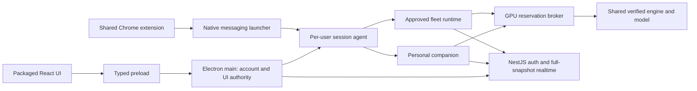

# Proposed Windows architecture

These are implementation directions, not a claim that the components exist.
W01 records any justified refinement before implementation. Product decisions
from the user remain fixed; routine internal choices do not need new approval.

## Components and reuse

Create a `windows-desktop/` component with its own manifest, lockfile, README,
main/preload/renderer boundaries and tests. Use Electron, React and TypeScript
with packaged local UI assets. Reuse web-client UI conventions where useful,
but do not copy its browser authentication persistence, audio-only product scope
or routing assumptions into the desktop product.

Keep the existing companion behavior under `chrome-extension/src/companion/`
and shared contracts under `chrome-extension/src/shared/` initially. Give the
desktop build an explicit, reproducible shared build entry; do not import sibling
`dist` opportunistically or create a root package workspace. If a separate shared
package becomes necessary, migrate only the needed boundary with regression
coverage and document its build order. Never fork two companion implementations.

Reuse `worker/` for the qualified Node/Python/FFmpeg/ONNX engine, scheduling,
transfer and signed runtime mechanisms. Add an explicit **per-user Windows
profile** rather than changing the meaning of the existing service profile.
The consumer application must not call elevated legacy install/update scripts.

The agent and fleet lifetime are independent of Electron's windows. Chrome can
reach personal processing when the UI is closed. No renderer or browser frame
receives a general filesystem, shell, credential-store or worker-admin API.

## Installation and data

| Area                 | Proposed Windows location and ownership                                                                                            |
| -------------------- | ---------------------------------------------------------------------------------------------------------------------------------- |
| App                  | `%LOCALAPPDATA%\Programs\MusicMute Local\`; per-user signed package with a stable launcher reference.                              |
| Personal data        | `%LOCALAPPDATA%\MusicMuteLocal\`; preferences, catalog, bounded cache/outboxes, setup journal and local diagnostics.               |
| Runtime/model        | Versioned, verified directories under the personal data root; one installed copy leased by personal and fleet consumers.           |
| Fleet identity/state | `%LOCALAPPDATA%\MusicMuteWorker\`; separate private credentials, intent, jobs and diagnostic state; references the shared runtime. |
| Chrome registration  | App-owned manifest and HKCU NativeMessagingHosts key for `com.musicmute.local`; keep the shared extension's allowed ID.            |
| Startup              | One app-owned HKCU Run entry for a stable session-agent launcher; no HKLM, SCM, scheduled elevated task or WinSW requirement.      |

Use Windows Known Folder APIs to resolve roots and explicit `path.win32` policy
in cross-host tests. Validate junctions/reparse points, case-insensitive aliases,
reserved names, alternate streams, traversal, UNC/device paths and long paths
according to each operation's allowlist. A user-selected input file is distinct
from an app-owned extraction/update directory. Never delete source files.

App upgrade preserves data, model, runtime, outboxes and worker identity. Normal
uninstall removes app-owned startup/Chrome registration and stops owned helpers;
it preserves data by default. Purge, account deletion and fleet revocation are
separate, explicit product actions. Shared-runtime cleanup must inspect leases
and both consumers before removal. Do not touch the old ProgramData service.

## Native adapter boundary

Use a small versioned native Windows helper/API for operations that Node cannot
securely express: current SID and session identity, explicit file/pipe ACLs,
process creation time, Job Objects, DPAPI and host architecture. Prefer reusing
existing native code/build machinery; otherwise a narrow C++ Win32 helper is
the default. Bundle every required runtime dependency; no end-user compiler,
PowerShell policy change, Python installation or administrator step.

The helper receives fixed operations and structured bounded input, never shell
strings or arbitrary executable names. Create local named pipes with explicit
current-user/session access rules and remote-client rejection. Authenticate
requests and validate operation-specific capabilities. A default pipe ACL is
insufficient. Bind owners to SID/session/PID/creation-time/nonce, not PID alone.
Treat clients running as the same OS user as potentially hostile input; DPAPI
does not provide isolation from every other process of that user.

Keep account secrets in a current-user vault available to the trusted account
broker; keep fleet credentials in a distinct namespace available without UI
login. Do not make the fleet agent depend on Electron safeStorage being alive.
The trusted broker may send short-lived account session material through the
existing validated native desktop protocol; Chrome and renderer see only safe
status/capabilities. Reuse UID/generation/installation fences throughout.

## Session-agent lifecycle

HKCU startup is a best-effort launch trigger, so app/Chrome also start the same
single-instance agent on demand. A bounded supervisor restarts its owned children
with backoff. It respects saved Stop/Pause/Drain and Windows startup-disable
choices; do not rewrite registry entries every launch to defeat the user.

| Event                   | Personal work                                                                                                                | Fleet work                                                                               |
| ----------------------- | ---------------------------------------------------------------------------------------------------------------------------- | ---------------------------------------------------------------------------------------- |
| First app run           | Automatically detect and prepare missing local prerequisites.                                                                | Offer/perform only already-authorized onboarding; never bypass Google/admin eligibility. |
| Close window            | Apply clear background-playback/work behavior; keep needed helpers alive.                                                    | Continues according to saved intent.                                                     |
| Quit personal app       | Resolve active personal work with explicit product confirmation; release its ownership safely. Chrome ownership is separate. | Continues according to saved intent.                                                     |
| MusicMute sign-out      | Keep account-free local work; clear account capabilities and fence outboxes.                                                 | Keeps its separately enrolled identity and saved intent.                                 |
| Windows lock            | No logout implied.                                                                                                           | Continues if resources/network permit.                                                   |
| Sleep/resume            | Reconcile capabilities, media and transfers; do not duplicate work.                                                          | Reconcile claims/leases before resuming; never replay stale claims.                      |
| Windows logout/shutdown | Bound shutdown, journal recovery and terminate owned process trees.                                                          | Stops; no unattended machine service remains.                                            |
| Next login              | Restore safe UI/setup state on demand.                                                                                       | Start only if installed, eligible, prepared and saved intent permits it.                 |

Assign owned child trees to Job Objects with tested close/termination semantics.
Detach the agent from the UI's lifetime, not from Windows user-session lifetime.
Never terminate foreign processes by image name.

## GPU selection and shared access

Enumerate real DXGI adapters, reject software adapters and try suitable hardware
in a deterministic order. Adapter index zero is not assumed to be the right GPU.
Resolve the chosen physical identity to the current ONNX device ordinal each
launch. Qualification binds model digest, runtime/provider version, device and
driver identity, fixture/recipe, observed execution placement and resources.
Driver/device/runtime/model changes invalidate the appropriate receipt.

Enforce no CPU model fallback both at session creation and during execution;
provider registration alone is insufficient. The existing profiling proof is a
starting point. If the pinned API cannot enforce the rule, fail preparation with
an actionable result; do not silently weaken the requirement. Determine support
and capacity by qualification, not a hardcoded GPU product name or invented VRAM.

One reservation authority coordinates personal app, Chrome and fleet work on
the selected GPU. Personal priority stops new fleet admission and waits for
accepted work and child cleanup to finish before taking the GPU. It does not
cancel an already accepted fleet job. Default to one inference slot until an
appropriate capacity receipt permits more.

Fast user switching can leave two Windows users logged in. W11 must implement a
cross-session, per-adapter contention guard that works without elevation and
shares no private APIs; a minimal global synchronization object is a candidate
requiring ACL/namespace verification. If safe coordination is unavailable, block
additional admission with “GPU busy” rather than assume isolation. Detect a
legacy service conflict without stopping or reconfiguring it. Denial of service
from another local process must not become unauthorized access or unsafe cleanup.

## Setup, updates and readiness

Prepare is a durable staged state machine: inspect → plan space/downloads →
download verified runtime components → extract into staging → install approved
upstream model → qualify GPU → activate → register/repair helpers → ready.
Resume only verified partial work. Remove completed archives after activation;
keep bounded rollback data. Ready means the selected local path actually meets
requirements, not merely that files exist or an account is logged in.

First installation, update, repair and explicit integrity checks perform full
verification. Normal launch uses an authenticated/bounded receipt plus cheap
identity and state checks, with a safe full-verification fallback. Never cache
readiness indefinitely or hash the whole model on every UI open.

App, runtime and model versions are independent. Reuse signed manifests and
inventory validation, with a consumer profile distinct from service releases.
Coordinate updates through leases for all consumers, stage atomically and roll
back after failed health checks. Authenticode and artifact-manifest signatures
solve different checks. Do not trust an unsigned hash fetched next to a download.

## Parity and account boundaries

Use the macOS source inventory as the feature baseline, including local video
audio extraction if currently supported there; do not inherit the web client's
audio-only limitation. Preserve output recipe/timeline identity and `trim=false`
for synchronized browser playback. Cloud mode is explicit, authenticated and
policy-gated; backend policy errors must not trigger local/cloud fallback.

Account data is partitioned by owner and session generation. Signing out fences
in-flight reads, grants, realtime snapshots and durable sync work. Library local
items and local playback remain usable. Account saving follows successful local
playback and never holds playback hostage to network success. Apply the existing
private/shared-media ownership rules; public release hosting is a separate R2
exception, never the application-media bucket.
